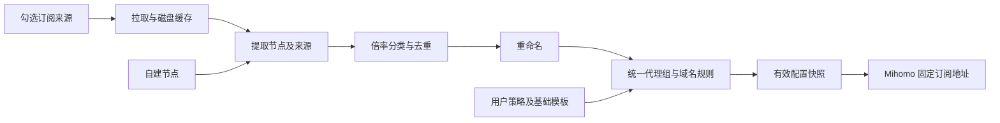

# clash_ACL

面向 Mihomo 的自建订阅聚合与策略生成器，计划使用 Go 实现，适合部署在低性能 VPS。

**当前状态：仅完成项目规划与开发约定，尚无可运行服务。** 以下能力均为待实现目标。

## 要解决的问题

多个订阅往往各自带有分组和分流规则，直接合并完整配置容易产生重复节点、组名冲突和规则覆盖。客户端扩展脚本还会把自建节点、倍率分组与服务策略分散在不同位置，维护成本较高。

clash_ACL 将来源节点与用户策略分离：选择需要聚合的来源，统一重命名、按倍率分类，再生成一份 Mihomo 配置。AI 服务可以绑定固定自建出口，避免普通代理组切换时改变 AI 出口。

## 计划能力

| 功能 | 目标行为 |
| --- | --- |
| 可选订阅聚合 | 支持单来源或勾选多个来源，只聚合节点 |
| 来源管理 | 启用开关、更新状态、缓存与失败提示 |
| 自建节点 | 独立管理节点，保留完整协议字段 |
| 节点身份与去重 | 保留来源及稳定 ID，不仅按节点名或服务器 IP 去重 |
| 重命名 | 来源前缀、文本与正则替换、效果预览 |
| 倍率分类 | 低倍率、标准倍率、高倍率；未知倍率进入标准组 |
| 代理组编辑 | 编辑组类型、成员条件、手动成员与顺序 |
| 域名分流 | 编辑域名、规则集、目标组及优先级 |
| AI 固定出口 | 指定自建节点，禁止自动切到机场或直连 |
| 服务专用策略 | 支持中转站等额外域名和链式代理关系 |
| 配置下载 | 固定下载地址，来源刷新后更新有效快照 |

首版支持 Clash/Mihomo YAML 来源与手动配置的自建节点；更多输入格式按需增加。

## 倍率分类

| 分类 | 条件 |
| --- | --- |
| 低倍率 | 明确识别的倍率 `< 1` |
| 标准倍率 | 明确识别的倍率 `= 1`，或未识别到倍率 |
| 高倍率 | 明确识别的倍率 `> 1` |

未识别到倍率只是按标准组处理，不代表确认该节点实际计费倍率为 1。支持节点手动覆盖与来源默认倍率。识别发生在重命名前，避免名称修改影响分类。

默认普通流量优先低倍率，高倍率通过明确选择启用，不作为低倍率故障后的自动备用。

## AI 固定出口

通过域名及域名规则集识别 AI 服务，不使用专用应用、进程名或进程路径规则。AI 中转站和其他服务的域名可以单独配置目标策略，不根据应用名称猜测路由。

AI 专用策略默认绑定一个自建节点。需要协议备用时，只允许加入已经验证出口 IP 相同的自建节点。专用策略不包含机场节点、普通节点选择组或 DIRECT；自建出口不可用时请求失败。

AI 规则优先于可能覆盖相同域名的通用微软、Google、国外媒体等规则。该约束适用于进入 Mihomo 且以 rule 模式处理的流量；生成器无法约束绕过代理或被客户端全局模式覆盖的请求。

## 实现方案

- Go 后端提供 API、订阅下载和静态页面，最终以单个程序部署。
- 前端在浏览器执行，不在 VPS 常驻前端开发服务。
- 首版使用本地配置文件和磁盘缓存；拉取并发初始上限为 2。
- 配置下载与来源刷新分离，下载优先返回已有有效快照。
- 来源失败时保留最近成功缓存；生成失败时不替换有效快照。
- 测速交给客户端 Mihomo，VPS 专注于订阅读取和配置生成。
- 真实订阅及节点凭据仅存于私有运行数据，不进入 Git。

## 开发顺序

1. Go 项目、配置存储与基础服务。
2. YAML 来源读取、刷新与缓存。
3. 多来源聚合、节点身份与去重。
4. 倍率分类与重命名预览。
5. 分组、AI 固定出口与域名规则生成。
6. 有效快照和固定下载地址。
7. 最小管理页面。
8. 客户端迁移验证与 VPS 部署。

随后改进可视化编辑体验，再按需要扩展 Provider 输出或其他输入格式。部署与运行命令将在对应功能实现后补充。

## 开发与交接

- 开发前阅读 [agent.md](agent.md) 和 [handoff.md](handoff.md)。
- 每完成一个功能点，都要验证、更新 handoff，并将相关代码与文档一起提交、推送 GitHub。
- 新配置应作为独立配置在客户端验证，确认后再处理旧扩展脚本，避免重复注入。
- Python 辅助操作一律使用 uv，详细规则见 agent.md。

仓库：[b1xcy/clash_ACL](https://github.com/b1xcy/clash_ACL)。
