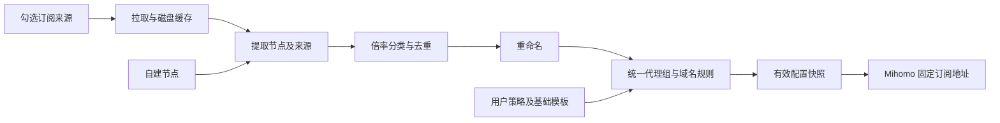

# clash_ACL

面向 Mihomo 的自建订阅聚合与策略生成器，使用 Go 实现，适合部署在低性能 VPS。

**当前状态：已实现基础 HTTP 服务、JSON 配置存储、访问控制和进度工作台，已补齐 Dockerfile。** YAML 订阅读取、聚合、倍率分类、AI 分流生成仍待实现，目前不能生成 Mihomo 订阅。

打开服务根地址（本地为 `http://127.0.0.1:8080/`），输入管理令牌即可查看功能进度、来源数量和启用状态。静态 HTML 内嵌在 Go 程序中，随 Docker 镜像交付，不依赖 CDN 或单独前端服务。令牌只保留在当前页面内存，不写入浏览器存储。

## 启动基础服务

从项目根目录构建并启动。两个令牌都可以省略，服务会自动生成：

```bash
docker build -t clash-acl:local .
docker run -d --name clash-acl --restart unless-stopped \
  -p 127.0.0.1:8080:8080 \
  -v clash-acl-data:/data \
  clash-acl:local
curl http://127.0.0.1:8080/healthz
docker logs clash-acl
```

Docker 使用非 root 用户运行。首次启动在数据卷中创建 `/data/config.json`；未设置的令牌使用安全随机数生成，并保存在 `/data/tokens.json`，容器重建后复用。新建令牌文件在 Linux 上的权限为 `0600`。上面的端口仅绑定本机，远程管理可通过 HTTPS 反向代理访问。

环境变量为空时，启动日志直接打印对应有效令牌，例如 `CLASH_ACL_ADMIN_TOKEN=...`；重启复用保存的随机令牌时也打印。显式设置的环境变量令牌不会打印。

需要指定令牌时，可创建本地 `.env` 文件，并在 `docker run` 中添加 `--env-file .env`。环境变量优先于保存的随机令牌；两个有效令牌不能相同。`.env` 已从 Git 和 Docker 构建上下文排除。

本地开发需要 Go 1.25.5 或更新版本，执行 `go run .` 即可；默认监听 `127.0.0.1:8080`，配置保存于 `data/config.json`，自动生成的令牌保存于 `data/tokens.json`。

| 环境变量 | 用途 | 默认值 |
| --- | --- | --- |
| `CLASH_ACL_ADMIN_TOKEN` | 配置管理令牌 | 空值时复用保存值或随机生成，并打印至启动日志 |
| `CLASH_ACL_DOWNLOAD_TOKEN` | 独立下载令牌 | 空值时复用保存值或随机生成，并打印至启动日志；不能与管理令牌相同 |
| `CLASH_ACL_LISTEN_ADDR` | HTTP 监听地址 | 本地 `127.0.0.1:8080`；镜像内 `0.0.0.0:8080` |
| `CLASH_ACL_DATA_DIR` | 私有配置目录 | 本地 `data`；镜像内 `/data` |

## 已实现 API

| 方法与路径 | 认证 | 行为 |
| --- | --- | --- |
| `GET /healthz` | 无 | 返回 `ok`，检查服务存活 |
| `GET /` | 无 | 返回内嵌进度工作台 HTML |
| `GET /api/status` | 管理令牌 | 返回功能进度、配置数量及不含 URL 的来源摘要 |
| `GET /api/config` | 管理令牌 | 返回当前完整配置 |
| `PUT /api/config` | 管理令牌 | 用 JSON 请求体整体替换并保存配置 |
| `GET /download` | 下载令牌 | 当前返回 HTTP 501，生成器尚未实现 |

认证使用 `Authorization: Bearer <令牌>`，目前不支持通过 URL 参数传令牌。配置读写接口供管理使用，返回的完整配置可能包含节点凭据；响应不缓存，日志和校验错误不打印来源 URL 或节点秘密。按项目约定，环境变量为空时的随机访问令牌在启动日志中直接打印。

```bash
curl -H 'Authorization: Bearer <管理令牌>' http://127.0.0.1:8080/api/config
```

配置结构包含 `fetch_concurrency`（默认 2）、`sources`、`self_hosted_nodes`、`rename_rules`、`groups`、`rules`、`ai` 与 `base`。自建节点使用 `{ "id": "fixed", "proxy": { ... } }`，`proxy` 保存完整 Mihomo 节点字段；`ai.node_id` 只能引用自建节点 ID。当前只保存这些策略，尚不执行生成。

PUT 是整体替换操作，更新前应先读取完整配置。非法 JSON、重复来源 ID、无效来源 URL 和不存在的 AI 节点引用会返回 HTTP 400，并保留原文件。成功写入使用同目录临时文件与重命名；节点扩展字段和 JSON 数字精度在读写中保留。

## 要解决的问题

多个订阅往往各自带有分组和分流规则，直接合并完整配置容易产生重复节点、组名冲突和规则覆盖。客户端扩展脚本还会把自建节点、倍率分组与服务策略分散在不同位置，维护成本较高。

clash_ACL 将来源节点与用户策略分离：选择需要聚合的来源，统一重命名、按倍率分类，再生成一份 Mihomo 配置。AI 服务可以绑定固定自建出口，避免普通代理组切换时改变 AI 出口。

## 后续计划能力

| 功能 | 目标行为 |
| --- | --- |
| 可选订阅聚合 | 支持单来源或勾选多个来源，只聚合节点 |
| 多行协议链接导入 | 每行一个节点链接，支持混合协议、导入预览及逐行错误反馈 |
| 来源管理 | 启用开关、更新状态、缓存与失败提示 |
| 自建节点 | 独立管理节点，保留完整协议字段 |
| 节点身份与去重 | 保留来源及稳定 ID，不仅按节点名或服务器 IP 去重 |
| 重命名 | 来源前缀、文本与正则替换、效果预览 |
| 倍率分类 | 低倍率、标准倍率、高倍率；未知倍率进入标准组 |
| 代理组编辑 | 编辑组类型、成员条件、手动成员与顺序 |
| 域名分流 | 编辑域名、规则集、目标组及优先级 |
| AI 固定出口 | 指定自建节点，禁止自动切到机场或直连 |
| 服务专用策略 | 支持中转站等额外域名的独立分流 |
| 配置下载 | 固定下载地址，默认快照下载，可带 `refresh=true` 强制刷新 |

首版计划支持 Clash/Mihomo YAML 来源、多行直接节点协议链接与手动配置的自建节点。协议链接包括 `ss://`、`tuic://`、`vless://`、`vmess://`、`trojan://`、`hysteria2://`（含 `hy2://`）和 `anytls://`；可混合粘贴，每行一个，忽略空行及首尾空白。

导入时预览有效节点并逐行显示解析错误，由用户确认导入。节点进入统一聚合、去重、重命名和倍率分组；未知倍率归标准倍率。完整 Base64 订阅等其他输入格式后续按需增加。**多行协议链接导入尚未实现。**

## 倍率分类

| 分类 | 条件 |
| --- | --- |
| 低倍率 | 明确识别的倍率 `< 1` |
| 标准倍率 | 明确识别的倍率 `= 1`，或未识别到倍率 |
| 高倍率 | 明确识别的倍率 `> 1` |

未识别到倍率只是按标准组处理，不代表确认该节点实际计费倍率为 1。支持节点手动覆盖与来源默认倍率。识别发生在重命名前，避免名称修改影响分类。

默认普通流量优先低倍率，高倍率通过明确选择启用，不作为低倍率故障后的自动备用。

## AI 固定出口

通过域名及域名规则集识别 AI 服务，不使用专用应用、进程名或进程路径规则。AI 中转站和其他服务的域名可以单独配置目标策略，不根据应用名称猜测路由。

AI 专用策略默认绑定一个自建节点。需要协议备用时，只允许加入已经验证出口 IP 相同的自建节点。专用策略不包含机场节点、普通节点选择组或 DIRECT；自建出口不可用时请求失败。

AI 规则优先于可能覆盖相同域名的通用微软、Google、国外媒体等规则。该约束适用于进入 Mihomo 且以 rule 模式处理的流量；生成器无法约束绕过代理或被客户端全局模式覆盖的请求。

## 实现方案



- Go 后端提供 API、订阅下载和静态页面，最终以单个程序部署。
- 前端在浏览器执行，不在 VPS 常驻前端开发服务。
- 首版使用本地配置文件和磁盘缓存；拉取并发初始上限为 2。
- 配置下载与来源刷新分离，下载优先返回已有有效快照。
- 下载请求带 `refresh=true` 时，重新拉取该配置启用的来源并等待生成结果；省略参数或使用 `refresh=false` 时不强制刷新。首次没有快照时执行一次生成。
- 强制刷新仍遵守并发限制和失败缓存策略；使用旧缓存时表明状态，无法生成有效配置时返回错误，不把旧快照冒充为刷新成功。
- 来源失败时保留最近成功缓存；生成失败时不替换有效快照。
- 测速交给客户端 Mihomo，VPS 专注于订阅读取和配置生成。
- 真实订阅及节点凭据仅存于私有运行数据，不进入 Git。

## 开发顺序

1. Go 项目、配置存储与基础服务。
2. YAML 来源读取、刷新与缓存，以及多行协议链接导入。
3. 多来源聚合、节点身份与去重。
4. 倍率分类与重命名预览。
5. 分组、AI 固定出口与域名规则生成。
6. 有效快照和固定下载地址。
7. 最小管理页面。
8. 客户端迁移验证、Docker 镜像构建与 VPS 部署。

第 1 项基础服务及 Docker 部署已完成，下一步实现 YAML 来源读取与缓存，以及新增的多行协议链接导入。随后改进可视化编辑体验，再按需要扩展 Provider 输出或其他输入格式。

## Docker 镜像发布

已提供 [GitHub Actions workflow](.github/workflows/docker-image.yml)，镜像托管于 GHCR：`ghcr.io/b1xcy/clash_acl`。

- 用户推送到 `main` 时发布 `latest`，推送 `v*` 标签时发布同名版本标签；同时发布提交 SHA 标签。
- 支持在 `main` 或 `v*` 标签上手动触发，使用 `GITHUB_TOKEN` 登录 GHCR。
- 初始构建平台为 `linux/amd64`；VPS 通过 Docker 拉取运行，配置与缓存使用数据卷持久化。

Dockerfile 采用多阶段构建，构建阶段运行 Go 测试并编译静态程序；运行阶段使用 scratch，只包含程序、HTTPS 根证书和数据目录。构建上下文仅包含 Go 源文件及模块定义，不打包 `.env` 或运行数据。

agent 只做本地 commit，尚未向 GHCR 发布镜像。用户推送后，workflow 将构建并发布基础服务镜像；发布完成后，上面的运行命令可以把 `clash-acl:local` 替换为 `ghcr.io/b1xcy/clash_acl:latest`。

## 开发与交接

- 开发前阅读 [agent.md](agent.md) 和 [handoff.md](handoff.md)。
- 每完成一个功能点，都要验证、更新 handoff，并将相关代码与文档一起做本地 commit；Git push 由用户自行执行。
- 新配置应作为独立配置在客户端验证，确认后再处理旧扩展脚本，避免重复注入。
- Python 辅助操作一律使用 uv，详细规则见 agent.md。

仓库：[b1xcy/clash_ACL](https://github.com/b1xcy/clash_ACL)。
