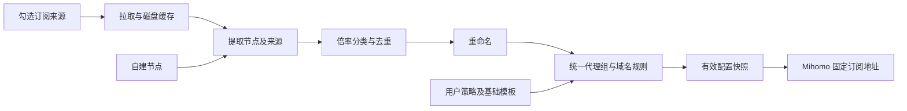

# clash_ACL

面向 Mihomo 的自建订阅聚合与策略生成器，使用 Go 实现，适合部署在低性能 VPS。

**当前状态：已实现基础服务、订阅转换表单、来源管理、远程 YAML 读取、后台刷新、磁盘缓存、节点预览、聚合去重、本地规则导入/排序预览与转换设置保存。** 已支持多行协议链接解析、逐行预览与当前页面确认；已支持倍率分类和重命名预览；AI 分流与完整配置生成仍待实现，目前不能生成完整 Mihomo 订阅。

打开服务根地址（本地为 `http://127.0.0.1:8080/`），使用类似 ACL4SSR 的订阅转换表单：输入多行订阅、选择 Mihomo 客户端、设置聚合，并在进阶模式编辑重命名、AI 自建出口和代理组配置。页面不展示开发进度。静态 HTML 内嵌在 Go 程序中，随 Docker 镜像交付，不依赖 CDN 或单独前端服务。打开即可使用，不需要登录或输入访问令牌。

当前可以通过请求参数读取订阅、预览节点、确认使用直接节点、预览聚合结果，并保存进阶设置；生成订阅、复制结果与导入客户端暂时禁用，不生成无效下载链接。聚合预览会执行本次倍率识别和重命名；保存设置只记录参数，分组与固定出口执行仍待生成器接入。

## 启动基础服务

从项目根目录构建并启动，无需配置令牌：

```bash
docker build -t clash-acl:local .
docker run -d --name clash-acl --restart unless-stopped \
  -p 127.0.0.1:8080:8080 \
  -v clash-acl-data:/data \
  clash-acl:local
curl http://127.0.0.1:8080/healthz
docker logs clash-acl
```

Docker 使用非 root 用户运行。首次启动在数据卷中创建 `/data/config.json`；数据卷保存转换设置与订阅缓存。服务不生成、读取或打印访问令牌。

本地开发需要 Go 1.25.5 或更新版本，执行 `go run .` 即可；默认监听 `127.0.0.1:8080`，配置保存于 `data/config.json`。

| 环境变量 | 用途 | 默认值 |
| --- | --- | --- |
| `CLASH_ACL_LISTEN_ADDR` | HTTP 监听地址 | 本地 `127.0.0.1:8080`；镜像内 `0.0.0.0:8080` |
| `CLASH_ACL_DATA_DIR` | 配置与缓存目录 | 本地 `data`；镜像内 `/data` |

## 已实现 API

| 方法与路径 | 行为 |
| --- | --- |
| `GET /healthz` | 返回 `ok`，检查服务存活 |
| `GET /` | 返回内嵌订阅转换表单 HTML |
| `GET /api/subscriptions?url=...` | 按请求地址读取缓存状态与节点预览；refresh=true 启动后台刷新 |
| `GET /api/status` | 返回接口能力、配置数量及不含 URL 的来源摘要 |
| `GET /api/config` | 返回当前完整配置 |
| `PUT /api/config` | 用 JSON 请求体整体替换并保存配置 |
| `GET /api/sources` | 返回可编辑的来源设置，包含订阅 URL |
| `PUT /api/sources` | 用 JSON 来源数组替换来源列表，保留其他配置 |
| `GET /api/options` | 返回重命名、AI、代理组设置及自建节点名称 |
| `PUT /api/options` | 保存转换设置，保留来源、自建节点和基础配置 |
| `POST /api/sources/refresh` | 启动启用来源的后台刷新，返回 HTTP 202 |
| `GET /api/sources/{id}/preview` | 从最近成功缓存返回节点名称与协议类型 |
| `POST /api/yaml/preview` | 解析请求体中的 YAML，仅预览，不保存 |
| `POST /api/uri/preview` | 解析多行协议链接，返回原行号、名称、协议、ID 与脱敏错误，不保存 |
| `POST /api/aggregate/preview` | 合并请求中的 YAML 缓存与有效直接链接，按连接参数去重并预览 |
| `GET /api/rules/presets` | 返回内置规则方案名称与 ID |
| `POST /api/rules/preview` | 读取本地 INI/规则文件，输出自定义优先的完整规则顺序 |
| `GET /download?url=...` | 接受订阅地址参数；生成器尚未实现，有效请求返回 HTTP 501 |

所有接口均无需认证。订阅地址通过重复的 url 查询参数传入，地址中的 &、? 等字符由调用端 URL 编码；aggregate=false 只读取第一条，默认启用全部。读取不会修改服务器上保存的来源列表，缓存仍保留在数据目录。

```bash
curl --get http://127.0.0.1:8080/api/subscriptions \
  --data-urlencode 'url=https://example.com/sub?token=example&format=clash' \
  --data-urlencode 'url=https://example.net/clash.yaml' \
  --data-urlencode 'aggregate=true' \
  --data-urlencode 'refresh=true'
```

接口先返回来源状态，使用相同 url 参数且省略 refresh 轮询，读取成功后响应的 previews 提供节点名称与类型。参数错误返回 400。/download 沿用同一组地址参数，但暂未实现配置生成。
配置读写接口保留，用于可选的服务器默认设置；前端读取订阅不依赖先保存配置。JSON 响应不缓存，日志和校验错误不打印完整来源地址或节点秘密。

配置结构包含 `fetch_concurrency`（默认 2）、`sources`、`self_hosted_nodes`、`rename_rules`、`groups`、`rules`、`ai` 与 `base`。自建节点使用 `{ "id": "fixed", "proxy": { ... } }`，`proxy` 保存完整 Mihomo 节点字段；`ai.node_id` 只能引用自建节点 ID。当前只保存这些策略，尚不执行生成。

PUT 是整体替换操作，更新前应先读取完整配置。非法 JSON、重复来源 ID、无效来源 URL 和不存在的 AI 节点引用会返回 HTTP 400，并保留原文件。成功写入使用同目录临时文件与重命名；节点扩展字段和 JSON 数字精度在读写中保留。

## 来源读取与缓存

在「订阅链接」中每行输入一个地址，点击「读取订阅」。聚合关闭时只读取第一行；展开本次来源后可查看节点和缓存。刷新任务在后台执行，页面自动更新来源状态；停用来源不会发起请求。`/api/subscriptions` 返回本次来源的节点数、上次刷新时间、错误、缓存状态与节点预览。

支持含 `proxies` 的 Clash/Mihomo 配置及 proxy-provider YAML。只提取节点，保留嵌套协议参数与扩展字段；来源自带分组和规则不合并。输入缺少节点、节点缺少名称或类型、多文档 YAML 等情况会明确报错。

- 来源缓存位于数据目录的 `cache/`，使用来源 ID 与 URL 的摘要作为文件名。修改 URL 后不会复用旧 URL 的缓存。
- 参数读取接口的并发上限为 2；已保存来源的刷新可通过 `fetch_concurrency` 调整。同一来源的重叠刷新共用一个任务。
- HTTP 请求超时为 20 秒，单个订阅上限为 8 MiB。
- 刷新失败时保留最近成功节点，显示 `using_cache: true` 和错误。没有成功缓存时明确显示失败。
- 页面与预览 API 只显示节点名称和协议，不公开服务器、密码或认证参数。完整节点参数保存在私有缓存中，供后续生成器使用。
- 「YAML 预览」支持粘贴本地配置，解析结果不会自动保存或导入。多行协议 URI 通过独立入口解析，见下文。

目前刷新由用户手动触发，尚未实现定时刷新与最终订阅下载的 `refresh=true` 逻辑。

## 聚合与去重预览

在读取订阅并确认直接节点后，点击「预览聚合与去重」。支持仅订阅、仅直接链接或混合输入；关闭聚合时只选第一条订阅，已确认直接节点仍参与聚合。

节点 ID 基于名称以外的完整连接参数计算；JSON 键顺序不影响 ID，数字和数字字符串形式的端口统一比较。协议、密码、UUID、TLS、传输层及扩展字段不同的节点分别保留，不根据同名或相同服务器地址删除。未显式提供的协议默认值不做推测合并。

同一节点出现于多个来源时，保留全部来源和原始名称，使用首次出现的名称。同名且不同连接参数的节点添加 ID 后缀；与内置策略名冲突时也改名。输入节点及完整参数保留，修改只发生在聚合输出副本中。

API 请求为 JSON：urls 数组、aggregate 布尔值和 direct_links 多行文本。启用来源尚无成功缓存或正在读取时返回 409，请先完成「读取订阅」。上游失败但有成功缓存时允许预览并明确提示缓存；直接链接含失败行则返回 400，不静默丢弃。响应仅包含 ID、名称、协议、来源及数量，不返回连接凭据，也不修改服务器来源配置。

聚合预览已应用倍率分类和重命名；代理组、域名规则与完整下载仍待生成器接入。

## 进阶模式设置

- 重命名支持按顺序执行文本与正则替换、编辑和保存；聚合预览显示最终名称，错误正则、空匹配和空结果会被拒绝。
- AI 出口只能选择已保存的自建节点，域名每行一个；选项接口仅提供节点 ID 和名称，不返回节点凭据。
- 代理组配置使用 JSON 数组，每个组需要 `name` 与 `type`。编辑器以原始 JSON 文本读写，保留数字精度。
- 设置保存使用独立接口，不更新订阅来源、自建节点、基础模板或原有域名规则。

倍率正则与重命名已接入聚合预览，并可保存/重新读取；AI 和代理组设置尚未接入最终配置生成器。

## 倍率与重命名预览

自动识别原始名称中的「倍率:0.5」「rate=0.5」「0.5x」「0.5倍」「0.5×」等标记。小于 1 为低倍率，等于 1 为标准，大于 1 为高倍率；未识别仍进标准组，但不会伪造实际倍率为 1。

识别先于重命名。重命名不会改变节点 ID 或原始来源名称；文本与正则按顺序执行，完成后处理同名和内置策略名冲突。来源限定规则只有匹配来源时生效。

同一连接节点的不同来源名称若给出不同明确倍率，记录冲突并暂用较高值；页面显示冲突数量。支持通过 API 手动覆盖，优先级为节点覆盖 → 原始名称识别 → 来源默认 → 标准兜底。

POST /api/aggregate/preview 增加可选 policy：
- rename_rules：文本/正则重命名数组，可含 source_id。
- rate_pattern：自定义正则，首个捕获组为数字；留空用自动识别。
- source_rates：以来源 ID 为键，设置 pattern 与 default。
- rate_overrides：以聚合节点 ID 为键，设置非负有限倍率。

响应节点包含 rate_group、rate_source、可选 rate、冲突和值；rate_counts 汇总低/标准/高、未知和冲突。RatePattern 与重命名可通过进阶「保存转换设置」保存；来源默认及节点覆盖目前通过 API 使用，尚未提供逐节点编辑界面。

## 本地规则导入与优先级

ACL4SSR 规则直接包含在项目和镜像中，前端支持 [ACL4SSR 官网远程配置](https://acl4ssr-sub.github.io/) 中全部 17 个 ACL4SSR 在线模板，或只使用自定义规则，不需要填写远程地址。17 个模板和 40 个规则文件位于 rules/ACL4SSR，Go embed 随二进制发布，规则读取无需联网。

- 默认系列：默认版、更多去广告、多国分组、无自动测速、无广告拦截。
- 精简系列：精简版、更多去广告、无自动测速、故障转移、多模式、多国分组。
- 完整系列：完整版、多模式、无自动测速、更多去广告、奈飞全量、谷歌细分。

这些方案目前提供规则序列和模板分组名称的预览；自动测速、故障转移、负载均衡和国家节点筛选等分组行为仍需接入实际组生成器。

INI 保持 ACL4SSR 的 ruleset=策略组,规则文件 与 []GEOIP/[]FINAL 写法；引用改为相对本地路径。例如：

```ini
[custom]
ruleset=🎯 全球直连,../LocalAreaNetwork.list
ruleset=🚀 节点选择,../ProxyLite.list
ruleset=🐟 漏网之鱼,[]FINAL
```

生成顺序为 **自定义规则 → 本地导入规则 → 最后一条兜底**，各层保留顺序，完全相同的重复规则保留第一次。外部模板的覆盖开关不会删除自定义规则。自定义 MATCH 优先于模板 FINAL，单独填写的兜底目标优先于两者。[Mihomo 匹配顺序](https://wiki.metacubex.one/config/rules/?h=rule+providers)。

模板中声明的分组名可以用于规则预览；可以用可选 JSON 映射改为自己的节点/分组，未知目标会报错。同名自定义组的实际生成优先级将在组生成器接入时验证，目前不产生完整分组配置。

Mihomo 不支持的外部 URL-REGEX/USER-AGENT 可以通过兼容选项跳过，页面明确列出数量、类型和位置；默认开启。自定义不支持的规则始终报错，不会静默跳过。不支持 RULE-SET/SUB-RULE 的依赖展开、远程地址、本地任意路径或执行外部脚本。

规则输入仅用于本次请求，不随「保存转换设置」持久化。此处已实现完整规则序列的导入/预览；自动 AI 规则、代理组生成与最终订阅下载尚未接入。

更新内置规则需编辑或重新导入仓库文件并构建镜像。来源快照和模板修改记录见 rules/ACL4SSR/SOURCE.md；并非运行时在线更新。[ACL4SSR 原模板](https://github.com/ACL4SSR/ACL4SSR/blob/master/Clash/config/ACL4SSR_Online.ini)。


## 要解决的问题

多个订阅往往各自带有分组和分流规则，直接合并完整配置容易产生重复节点、组名冲突和规则覆盖。客户端扩展脚本还会把自建节点、倍率分组与服务策略分散在不同位置，维护成本较高。

clash_ACL 将来源节点与用户策略分离：选择需要聚合的来源，统一重命名、按倍率分类，再生成一份 Mihomo 配置。AI 服务可以绑定固定自建出口，避免普通代理组切换时改变 AI 出口。

## 功能范围

| 功能 | 目标行为 |
| --- | --- |
| 可选订阅聚合 | 支持单来源或勾选多个来源，只聚合节点 |
| 多行协议链接导入 | 每行一个节点链接，支持混合协议、导入预览及逐行错误反馈 |
| 来源管理 | 启用开关、更新状态、缓存与失败提示 |
| 自建节点 | 独立管理节点，保留完整协议字段 |
| 节点身份与去重 | 保留来源及稳定 ID，不仅按节点名或服务器 IP 去重 |
| 重命名 | 来源前缀、文本与正则替换、效果预览 |
| 倍率分类 | 低倍率、标准倍率、高倍率；未知倍率进入标准组 |
| 代理组编辑 | 编辑组类型、成员条件、手动成员与顺序 |
| 域名分流 | 编辑域名、规则集、目标组及优先级 |
| AI 固定出口 | 指定自建节点，禁止自动切到机场或直连 |
| 服务专用策略 | 支持中转站等额外域名的独立分流 |
| 配置下载 | 固定下载地址，默认快照下载，可带 `refresh=true` 强制刷新 |

已支持 Clash/Mihomo YAML 来源读取与多行直接节点协议链接解析；自建节点可保存完整 Mihomo 字段。协议链接包括 `ss://`、`tuic://`、`vless://`、`vmess://`、`trojan://`、`hysteria2://`（含 `hy2://`）和 `anytls://`；可混合粘贴，每行一个，忽略空行及首尾空白。

在「直接节点链接」中粘贴，每行一个，点击「解析预览」后逐行查看名称、协议与错误。点击「使用有效节点」确认使用本次有效行，失败行不会导入；再次确认会替换当前页面的直接节点列表。链接仅保留在页面内存，刷新页面清空，不保存到服务器全局配置，也不会远程访问链接中的服务器。

支持 SS SIP002 与旧版整体 Base64 链接、TUIC v4/v5、VLESS Reality、VMess Base64 JSON 与 AEAD URI、Trojan、Hysteria2/hy2、AnyTLS。支持 IPv6、百分号解码、基础 TLS/SNI/ALPN、WS、gRPC、HTTP/H2 和常见 SS 插件参数。Hysteria2 和 AnyTLS 省略端口时使用 443；其他协议需指定端口。

当前不支持 Hysteria2 端口跳跃、Realm/ECH、XHTTP、AnyTLS 的 IP SNI 语义、任意插件及自定义扩展字段；未映射参数、冲突参数或不支持的传输会明确报错，不静默丢弃。需要保留这些设置时使用 Mihomo YAML。完整 Base64 订阅后续按需增加。

确认使用不代表已经生成订阅。聚合预览已接收当前页面的有效链接，与 YAML 缓存一起去重；后续完成重命名和倍率分组，未知倍率归标准倍率。当前最终生成仍未实现。

格式依据：[Shadowsocks SIP002](https://shadowsocks.org/doc/sip002.html)、[Hysteria2 URI](https://v2.hysteria.network/docs/developers/URI-Scheme/)、[AnyTLS URI](https://github.com/anytls/anytls-go/blob/main/docs/uri_scheme.md)、[Mihomo 转换实现](https://github.com/MetaCubeX/mihomo/blob/Meta/common/convert/converter.go)。

## 倍率分类

| 分类 | 条件 |
| --- | --- |
| 低倍率 | 明确识别的倍率 `< 1` |
| 标准倍率 | 明确识别的倍率 `= 1`，或未识别到倍率 |
| 高倍率 | 明确识别的倍率 `> 1` |

未识别到倍率只是按标准组处理，不代表确认该节点实际计费倍率为 1。支持节点手动覆盖与来源默认倍率。识别发生在重命名前，避免名称修改影响分类。

默认普通流量优先低倍率，高倍率通过明确选择启用，不作为低倍率故障后的自动备用。

## AI 固定出口

通过域名及域名规则集识别 AI 服务，不使用专用应用、进程名或进程路径规则。AI 中转站和其他服务的域名可以单独配置目标策略，不根据应用名称猜测路由。

AI 专用策略默认绑定一个自建节点。需要协议备用时，只允许加入已经验证出口 IP 相同的自建节点。专用策略不包含机场节点、普通节点选择组或 DIRECT；自建出口不可用时请求失败。

AI 规则优先于可能覆盖相同域名的通用微软、Google、国外媒体等规则。该约束适用于进入 Mihomo 且以 rule 模式处理的流量；生成器无法约束绕过代理或被客户端全局模式覆盖的请求。

## 实现方案



- Go 后端提供 API、订阅下载和静态页面，最终以单个程序部署。
- 前端在浏览器执行，不在 VPS 常驻前端开发服务。
- 首版使用本地配置文件和磁盘缓存；拉取并发初始上限为 2。
- 配置下载与来源刷新分离，下载优先返回已有有效快照。
- 下载请求带 `refresh=true` 时，重新拉取该配置启用的来源并等待生成结果；省略参数或使用 `refresh=false` 时不强制刷新。首次没有快照时执行一次生成。
- 强制刷新仍遵守并发限制和失败缓存策略；使用旧缓存时表明状态，无法生成有效配置时返回错误，不把旧快照冒充为刷新成功。
- 来源失败时保留最近成功缓存；生成失败时不替换有效快照。
- 测速交给客户端 Mihomo，VPS 专注于订阅读取和配置生成。
- 真实订阅及节点凭据仅存于私有运行数据，不进入 Git。

## 开发顺序

1. Go 项目、配置存储与基础服务。
2. YAML 来源读取、刷新与缓存，以及多行协议链接导入。
3. 多来源聚合、节点身份与去重。
4. 倍率分类与重命名预览。
5. 分组、AI 固定出口与域名规则生成。
6. 有效快照和固定下载地址。
7. 最小管理页面。
8. 客户端迁移验证、Docker 镜像构建与 VPS 部署。

基础服务、Docker 部署、来源 YAML 读取与缓存、多行协议链接解析与确认、转换表单及设置保存已完成。节点身份与聚合去重预览已完成，本地规则导入与排序预览也已完成，倍率与重命名预览已完成，下一步接入分组、AI 固定出口和完整配置生成/下载。

## Docker 镜像发布

已提供 [GitHub Actions workflow](.github/workflows/docker-image.yml)，镜像托管于 GHCR：`ghcr.io/b1xcy/clash_acl`。

- 用户推送到 `main` 时发布 `latest`，推送 `v*` 标签时发布同名版本标签；同时发布提交 SHA 标签。
- 支持在 `main` 或 `v*` 标签上手动触发，使用 `GITHUB_TOKEN` 登录 GHCR。
- 初始构建平台为 `linux/amd64`；VPS 通过 Docker 拉取运行，配置与缓存使用数据卷持久化。

Dockerfile 采用多阶段构建，构建阶段按 `go.mod` 与 `go.sum` 下载 YAML 依赖、运行 Go 测试并编译静态程序；运行阶段使用 scratch，只包含内嵌 HTML 的程序、HTTPS 根证书和数据目录。构建上下文仅包含源码、HTML 及模块定义，不打包 `.env` 或运行数据。

agent 只做本地 commit，尚未向 GHCR 发布镜像。用户推送后，workflow 将构建并发布基础服务镜像；发布完成后，上面的运行命令可以把 `clash-acl:local` 替换为 `ghcr.io/b1xcy/clash_acl:latest`。

## 开发与交接

- 开发前阅读 [agent.md](agent.md) 和 [handoff.md](handoff.md)。
- 每完成一个功能点，都要验证、更新 handoff，并将相关代码与文档一起做本地 commit；Git push 由用户自行执行。
- 新配置应作为独立配置在客户端验证，确认后再处理旧扩展脚本，避免重复注入。
- Python 辅助操作一律使用 uv，详细规则见 agent.md。

仓库：[b1xcy/clash_ACL](https://github.com/b1xcy/clash_ACL)。

每次代码改动完成后必须执行 `docker build -t clash-acl:local .`，验证本次代码与 HTML 随镜像交付，再做本地提交。
